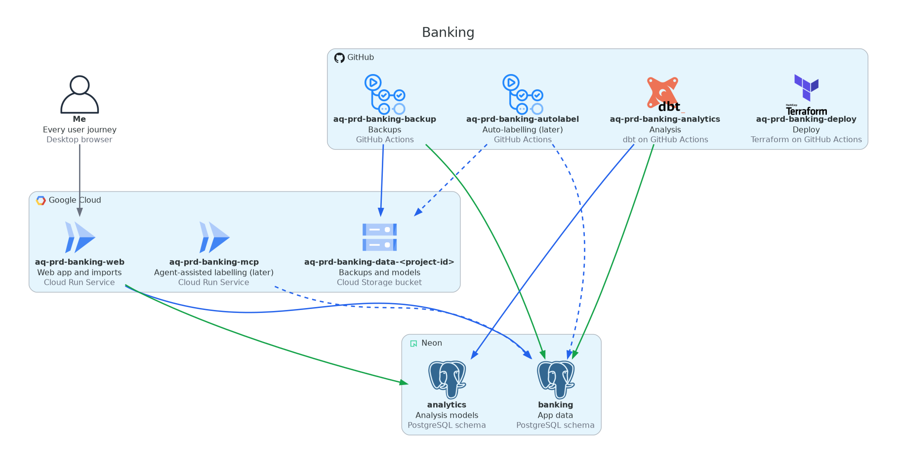

# Banking: technical architecture

> Components and the roadmap features each one supports. Feature scope lives in the
> [README roadmap](../README.md#roadmap) and the GitHub issues; general rules in the
> [root CLAUDE.md](../../../CLAUDE.md), banking overrides in [CLAUDE.md](../CLAUDE.md).

## Overview
A Postgres database is the single store for all banking data. A single FastAPI + HTMX web
app covers every user flow, from data editing to import, labelling and analysis. dbt turns the stored data into analysis models. Scheduled and
on-demand work runs as GitHub Actions jobs. The web app's code follows the three layers
(api → services → databases, around shared domains) of the
[root CLAUDE.md](../../../CLAUDE.md#app-code-structure).

Arrows: grey uses, blue reads and writes, green reads only. Dashed arrows and "(later)"
mark planned components. Source: [architecture.py](architecture.py).

## Components
| Component | Runs on | Features it supports |
| --- | --- | --- |
| **Web app** (FastAPI + HTMX) | Cloud Run | Banks (add, rename, delete); accounts (declare, edit, close, delete); statement import with summary and freshness indicator; categories (add, rename, merge); labelling queue; manual operations and balances; corrections; monthly analysis pages |
| **Importers** (one module per bank/format, inside the web app) | Cloud Run | Banque Postale CSV; PDF statements; CFCAL and Fortuneo files; bank/account auto-detection |
| **Postgres** | Neon (`prd`), Docker (`loc`) | Stores all app data, for every feature |
| **dbt** (dbt-postgres) | Jobs, models in Postgres | Monthly analysis: spending by category, savings rate, net worth; internal transfer reporting |
| **Jobs** | GitHub Actions | Deploy; backups; analytics compute (`dbt build`); auto-labelling training and inference |
| **Cloud Storage** | GCP | Backups; trained auto-labelling model |
| **MCP server** (optional) | Cloud Run | Agent-assisted labelling; every journey also works without it |

## App data vs analytics
- **SQLAlchemy + Alembic own the `banking` schema**: the tables the app writes (accounts,
  imports, operations, categories, labels). Only Alembic migrations change them.
- **dbt owns the `analytics` schema**: it reads the `banking` tables as sources, never writes
  them, and builds the analysis models. Alembic never touches `analytics`.
- **The web app reads `analytics`** to show the analysis pages.
- **Contract**: dbt declares the `banking` tables as sources and holds tests on them.

## Data model
Defined in [databases/models](../src/banking/databases/models/). Constraints are named
`uq_`/`ck_`/`fk_` + table + column/rule, so the services can map a violation to the field
at fault.

- **`banks`**: `name` (unique). Managed by the user; a bank used by an account can't be
  deleted (`accounts.bank_id` foreign key, `ON DELETE RESTRICT`).
- **`accounts`**: `name` (unique), `bank_id`, `type` (fixed list, `CHECK`: the analysis
  relies on it), `account_number` (unique, optional), `opened_on`, `closed_on`
  (`CHECK closed_on >= opened_on`). Closing keeps the account and its history; there is no
  reopen. Deleting removes the account and, through `ON DELETE CASCADE`, its history.
- **`imports`**: one row per imported export file (the file itself is never stored):
  `export_date`, header `balance`, dates covered, `rows_in_file`, `rows_new`. Freshness
  counts days since the account's latest `export_date`: warning at 61, alert at 76.
- **`operations`**: `operation_date`, `description` (the bank's text, never edited),
  `amount`, `occurrence`, and the `import_id` that added it. Identical same-day
  operations are real, so `occurrence` numbers the copies: unique
  `(account_id, operation_date, description, amount, occurrence)`. An import adds the
  copies beyond those stored, with the account row locked (`FOR UPDATE`), in one
  transaction.
- Both reference `accounts` with `ON DELETE CASCADE`.
- **`categories`**: `name` (unique): the type of an expense or income.
  Renaming keeps the labels (they hold the id). A category in use can't be deleted
  (`labels.category_id`, `ON DELETE RESTRICT`); merging moves its labels to another, then
  deletes it, in one transaction.
- **`labels`**: at most one per operation (`operation_id` primary key, `ON DELETE
  CASCADE`): `category_id`, `source` (`suggestion` accepted or `manual`, `CHECK`), and
  `created_at` for the labelling-time metric. No tags or notes, to stay simple.
  "Same as last time": two operations match when their descriptions do once every word
  holding a digit is dropped (card date, card number, references), ignoring case and
  spacing. The suggested category is the latest matching label's, computed on each request
  rather than stored, so the rule can be tuned. The server decides the `source`, never the
  client.

## Front end
Server-rendered pages and plain forms. htmx is used only to edit a label in place on the
account page, and every htmx link or form also works without JavaScript. It is vendored
and pinned (`src/banking/api/static/htmx-<version>.min.js`, checked against npm's checksum
when vendoring) and served by the app: no third-party origin at runtime. Dependabot can't
see it, so upgrades are made by hand, and the version in the file name keeps them visible.

## Security
TODO: defined with #14.
