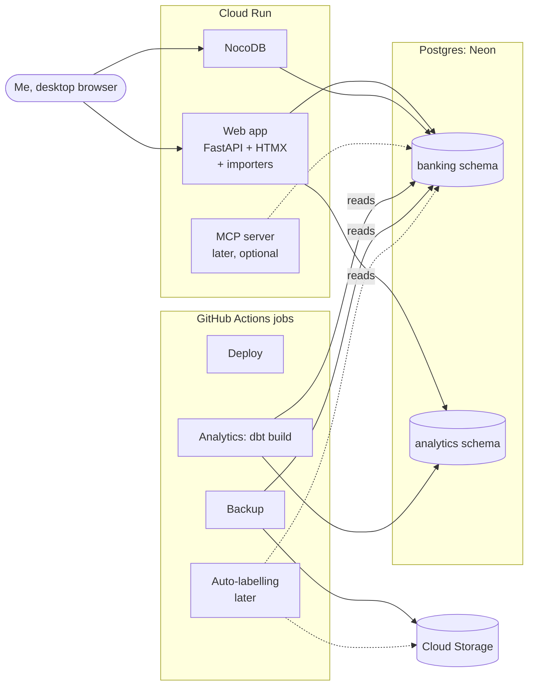

# Banking: technical architecture

> Components and the roadmap features each one supports. Feature scope lives in the
> [README roadmap](../README.md#roadmap) and the GitHub issues; general rules in the
> [root CLAUDE.md](../../../CLAUDE.md), banking overrides in [CLAUDE.md](../CLAUDE.md).

## Overview
A Postgres database is the single store for all banking data. A FastAPI + HTMX web app
covers the flows that need custom UX (import, labelling, analysis); NocoDB covers plain data
editing on the same tables. dbt turns the stored data into analysis models. Scheduled and
on-demand work runs as GitHub Actions jobs.

## Components
| Component | Runs on | Roadmap features it supports |
| --- | --- | --- |
| **Web app** (FastAPI + HTMX) | Cloud Run | CSV import with summary and freshness indicator ([#12](https://github.com/machbry/autoquest/issues/12)); labelling queue and category merge ([#13](https://github.com/machbry/autoquest/issues/13)); monthly analysis pages (Next); PDF and other banks' imports (Next/Later) |
| **Importers** (one module per bank/format, inside the web app) | Cloud Run | Banque Postale CSV (#12); PDF backfill (Next); CFCAL/Fortuneo files and bank/account auto-detection (Later) |
| **NocoDB** | Cloud Run | Declare/close accounts (#12); add/rename categories (#13); manual operations and balances (Next); corrections |
| **Postgres** | Neon (`prd`), Docker (`loc`) | Stores all app data, for every feature |
| **dbt** (dbt-postgres) | Jobs, models in Postgres | Monthly analysis: spending by category, savings rate, net worth; internal transfer reporting (Next) |
| **Jobs** | GitHub Actions | Deploy and backups ([#14](https://github.com/machbry/autoquest/issues/14)); analytics compute with `dbt build` (Next); auto-labelling training and inference (Later) |
| **Cloud Storage** | GCP | Backups (#14); trained auto-labelling model (Later) |
| **MCP server** (optional) | Cloud Run | Agent-assisted labelling (Later); every journey also works without it |

## App data vs analytics
- **SQLAlchemy + Alembic own the `banking` schema**: the tables the web app and NocoDB write
  (accounts, imports, operations, categories, labels). Only Alembic migrations change them.
- **dbt owns the `analytics` schema**: it reads the `banking` tables as sources, never writes
  them, and builds the analysis models. Alembic never touches `analytics`.
- **The web app reads `analytics`** to show the analysis pages.
- **Contract**: dbt declares the `banking` tables as sources and holds tests on them.

## Data model
TODO: defined with #12 and #13.

## Security
TODO: defined with #14.
